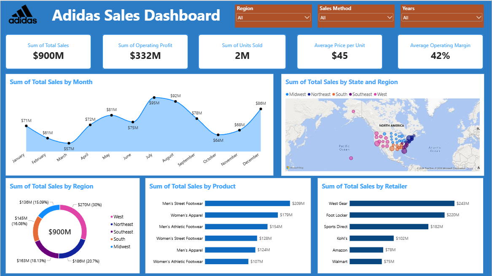

# Adidas Sales Dashboard

An end-to-end analytics project built on the Adidas US sales dataset: 9,648
transaction rows across 6 retailers, 5 regions, and 50 states (Jan 2020 –
Dec 2021). The project covers a column-level data-quality audit, star-schema
modeling in Power BI, 22 DAX measures, and an executive dashboard reporting
revenue, operating profit, margin, channel mix, and geographic performance.

The core question driving the work: the published headline figure for this
dataset is **$900M in total sales**, but `Units Sold × Price per Unit` only
accounts for **$120M**. Which of the two is the dataset actually measuring, and
can a dashboard be built on it at all?


---

## Dataset Overview

| Attribute | Value |
|---|---|
| Transaction rows | 9,648 |
| Period | 1 Jan 2020 – 31 Dec 2021 |
| Retailers | 6 |
| Distinct Retailer IDs | 4 (not a valid key — see Limitations) |
| Regions | 5 |
| States | 50 |
| Cities | 52 |
| Products | 6 |
| Sales methods | 3 |
| Total sales | $899,902,125 |
| Operating profit | $332,134,761 |
| Units sold | 2,478,861 |
| Weighted operating margin | 36.91% |
| Mean of `Operating Margin` column | 42.30% |
| Mean of `Price per Unit` column | $45.22 |
| Implied price per unit (sales ÷ units) | $363.03 |
| Missing values | 0 across all 13 columns |
| Exact duplicate rows | 0 |

One row is a **retailer–product–day aggregate**, not an individual order. There
is no order ID, customer ID, or cost column, so order-level, customer-level,
and gross-vs-net analysis are all out of scope by construction.

## Project Scope

1. **Data quality audit** — profiled all 13 columns for completeness,
   duplication, type consistency, and internal arithmetic consistency. Found no
   missing values and no exact duplicates, but identified 4 rows with
   `Units Sold = 0` and `Total Sales = 0`, and one structural inconsistency
   affecting 40.3% of rows (below).
2. **Arithmetic reconciliation** — tested three internal identities:
   `Total Sales = Units Sold × Price per Unit`,
   `Operating Margin = Operating Profit ÷ Total Sales`, and
   `Price per Unit` against the implied average. The second holds for all 9,644
   non-zero rows to within rounding; the first fails on 3,886 rows by a factor
   of exactly 10.
3. **Data modeling (Power BI)** — flat fact table plus a dedicated `DimDate`
   calendar table marked as date table, joined one-to-many on
   `DimDate[Date] → Sales[Invoice Date]`, with `Bulan` sorted by its numeric
   helper column so the monthly axis runs January to December rather than
   alphabetically.
4. **DAX measures** — 22 measures covering core KPIs, time intelligence
   (prior-year, YTD, MoM, rolling total), share and ranking, channel mix, and a
   dynamic filter-responsive title.
5. **Dashboard** — 5 KPI cards, monthly trend, state-level map, regional
   composition, product and retailer rankings, and 4 slicers.

## Key Findings

- **40.3% of rows carry a 10× scale inconsistency.** In 3,886 rows,
  `Total Sales` equals exactly 10 × (`Units Sold` × `Price per Unit`); in the
  remaining 5,758 rows the identity holds exactly. There is no intermediate
  case — the ratio is either 1.0 or 10.0. Those 3,886 rows hold **96.3% of all
  reported revenue**, so the headline $900M is almost entirely a product of the
  affected group. Reconciling to units × price would put total sales at $120M
  and the average unit price at $48, which is consistent with the stated
  `Price per Unit` range of $7–$110.
- **The inconsistency is not randomly distributed — it is structural by
  channel.** All 1,740 In-store rows are affected (100%), against 1,145 of
  3,019 Outlet rows (37.9%) and 1,001 of 4,889 Online rows (20.5%). The
  consequence shows up directly in the channel comparison: In-store reports
  $357M on 689,990 units ($517 per unit) while Online reports $248M on 939,093
  units ($264 per unit). **Online sells 36% more units than In-store but
  reports 30% less revenue.** Any channel conclusion drawn from this dataset as
  published is an artifact of the scaling, not a commercial finding.
- **Year-over-year growth of +294% is a coverage effect, not performance.**
  2020 contains 1,302 rows covering 9 states and 5 retailers; 2021 contains
  8,346 rows covering 46 states and all 6 retailers. Amazon appears only in
  2021, and Kohl's records $0.76M in 2020 against $101.4M in 2021. Both years
  span all 12 months, so the gap is geographic and retailer rollout, not
  seasonality or a partial year.
- **Margin and volume pull in opposite directions geographically.** West leads
  on revenue at $269.9M (30.0% of total) but posts the lowest weighted margin
  at 33.2%; South ranks fourth on revenue at $144.7M yet holds the highest
  margin at 42.3%. A revenue-only reading of the regional donut inverts the
  profitability ranking.
- **Men's Street Footwear is the only category that leads on both axes** —
  $208.8M in sales (23.2% of total) at a 39.7% weighted margin, the highest of
  the six. Men's Athletic Footwear is the weakest on margin at 33.7%.
- **Sports Direct converts best.** It ranks third on revenue ($182.5M) but
  first on weighted margin (40.7%), while West Gear leads revenue ($243.0M) at
  35.3%. Walmart is last on both counts.
- Seasonality is moderate: July peaks at $95.5M against a March trough of
  $56.8M, a ratio of 1.68× — considerably flatter than a typical retail
  calendar, with a secondary December peak at $85.8M.
- **No transaction in the dataset loses money.** `Operating Margin` ranges from
  10.0% to 80.0% with no negative values across all 9,648 rows. Discount
  analysis, loss-making transaction analysis, and margin-erosion studies are
  therefore impossible here — the dataset contains no downside to analyse.

## DAX Measures (22)

| Measure | Formula | Purpose |
|---|---|---|
| Total Sales | `SUM(Sales[Total Sales])` | Reported revenue |
| Operating Profit | `SUM(Sales[Operating Profit])` | Reported operating profit |
| Units Sold | `SUM(Sales[Units Sold])` | Units sold |
| Price per Unit | `AVERAGE(Sales[Price per Unit])` | Mean listed unit price, as shown on the KPI card |
| Operating Margin | `AVERAGE(Sales[Operating Margin])` | Unweighted mean of per-row margin, reproduces the published 42% |
| Operating Margin % | `DIVIDE([Operating Profit], [Total Sales])` | Weighted margin, the correct figure for business use |
| Avg Price per Unit (weighted) | `DIVIDE([Total Sales], [Units Sold])` | Revenue per unit; diverges sharply from the listed price |
| Total Transaksi | `COUNTROWS(Sales)` | Row count — aggregates, not orders |
| Jumlah State Aktif | `DISTINCTCOUNT(Sales[State])` | States with recorded sales, used to expose 2020 coverage |
| Avg Sales per Transaksi | `DIVIDE([Total Sales], [Total Transaksi])` | Mean value per aggregate row |
| Online Sales % | `DIVIDE(CALCULATE([Total Sales], Sales[Sales Method]="Online"), [Total Sales])` | Online share of revenue |
| Sales LY | `CALCULATE([Total Sales], SAMEPERIODLASTYEAR(DimDate[Date]))` | Prior-year sales in the matching period |
| Sales YoY % | `DIVIDE([Total Sales] - [Sales LY], [Sales LY])` | Year-over-year revenue growth |
| Profit LY | `CALCULATE([Operating Profit], SAMEPERIODLASTYEAR(DimDate[Date]))` | Prior-year operating profit |
| Profit YoY % | `DIVIDE([Operating Profit] - [Profit LY], [Profit LY])` | Year-over-year profit growth |
| Sales YTD | `TOTALYTD([Total Sales], DimDate[Date])` | Cumulative sales from the start of the year |
| Sales MoM % | `DIVIDE([Total Sales] - CALCULATE([Total Sales], DATEADD(DimDate[Date], -1, MONTH)), CALCULATE([Total Sales], DATEADD(DimDate[Date], -1, MONTH)))` | Month-over-month change |
| Running Total Sales | `CALCULATE([Total Sales], FILTER(ALLSELECTED(DimDate[Date]), DimDate[Date] <= MAX(DimDate[Date])))` | Cumulative line for the trend chart |
| % of Total Sales | `DIVIDE([Total Sales], CALCULATE([Total Sales], ALLSELECTED(Sales)))` | Share of total, used by the regional donut |
| Rank Retailer | `RANKX(ALLSELECTED(Sales[Retailer]), [Total Sales], , DESC, DENSE)` | Retailer ranking by revenue |
| Rank Product | `RANKX(ALLSELECTED(Sales[Product]), [Total Sales], , DESC, DENSE)` | Product ranking by revenue |
| Top Product | `VAR T = TOPN(1, ALLSELECTED(Sales[Product]), [Total Sales], DESC) RETURN CONCATENATEX(T, Sales[Product], ", ")` | Highest-revenue product, responsive to filters |

> `Operating Margin` and `Operating Margin %` are both kept deliberately. The
> published dashboard reports 42%, which is the unweighted mean of a ratio
> column — it treats a $160 row and a $600,000 row as equally informative. The
> weighted figure is 36.91%. Keeping both makes the gap visible rather than
> hiding it behind a single number.

> `CONCATENATEX` guards `Top Product` against ties: if two products share the
> same revenue, both names return comma-separated rather than the measure
> returning blank.

## Dashboard Components

| Section | Visual | Fields |
|---|---|---|
| Header | Image + text box | Logo, report title |
| Filters | Slicer (dropdown) | `Sales[Region]`, `Sales[Sales Method]`, `DimDate[Tahun]`, `DimDate[Date]` |
| KPI row | 5 × Card | Total Sales, Operating Profit, Units Sold, Price per Unit, Operating Margin |
| Trend | Area chart | `DimDate[Bulan]` × `[Total Sales]`, data labels in millions |
| Geography | Map (bubble) | Location `Sales[State]`, size `[Total Sales]`, legend `Sales[Region]` |
| Composition | Donut | `Sales[Region]` × `[Total Sales]`, value and percent-of-total labels |
| Ranking | Clustered bar | `Sales[Product]` × `[Total Sales]`, sorted descending |
| Ranking | Clustered bar | `Sales[Retailer]` × `[Total Sales]`, sorted descending |

The map legend is bound to `Region`, not `State`. Binding it to `State` would
duplicate the Location field and produce 50 indistinguishable colours; `Region`
adds a second dimension in 5 readable categories and shares its palette with
the donut, so the two panels read as one story.

`Product` and `Retailer` are deliberately left out of the slicer panel — both
already have bar charts, and cross-filtering by clicking a bar covers the same
need without spending header space.

## Repository Structure

```
.
├── data/
│   └── Adidas_US_Sales_Datasets.xlsx   # source dataset, single sheet
├── pbix/
│   └── AdidasSales.pbix
├── docs/
│   ├── measures.md                     # DAX reference with notes
│   └── dashboard.png
└── README.md
```

## How to Reproduce

1. Open `pbix/AdidasSales.pbix` in Power BI Desktop (May 2024 release or later).
2. If the source path breaks, go to Transform data → Data source settings and
   repoint to your local `data/Adidas_US_Sales_Datasets.xlsx`, sheet
   `Data Sales Adidas`.
3. **Set the import locale to English (United States)** — the workbook uses `.`
   as the decimal separator, and an Indonesian locale will misread
   `Operating Margin` and `Price per Unit`.
4. Confirm the model loads correctly: with no filters applied, `Total Sales`
   must read **899,902,125**, `Operating Profit` **332,134,761**, and
   `Units Sold` **2,478,861**. Any other figure points to a locale or
   date-parsing issue at import.
5. Verify `DimDate` is marked as a date table and the relationship to
   `Invoice Date` is active, otherwise every time-intelligence measure returns
   the grand total for all periods.
6. Check that `Bulan` is sorted by `Nomor Bulan` in Column tools. Without it the
   monthly axis reads April, August, December first.

## Known Limitations

- **The 10× scaling inconsistency is unresolved and unresolvable from the data
  alone.** It cannot be determined whether `Total Sales` is inflated tenfold in
  3,886 rows or `Units Sold` is understated tenfold in the same rows — both
  produce the observed pattern, and `Operating Profit` was scaled consistently
  with `Total Sales`, so internal checks cannot adjudicate. This dashboard
  reports the figures as published, which keeps it comparable to other work on
  this dataset, but **every revenue, profit, and unit-price figure here carries
  that uncertainty**. It must be settled with the data owner before any number
  informs a pricing or channel decision.
- Because the inconsistency concentrates entirely in In-store rows, the
  `Sales Method` dimension is unsafe for reporting as-is. It is kept in the
  model as a slicer, but no visual presents channel revenue as a headline.
- **`Retailer ID` is not a valid key.** 4 distinct IDs map to 6 retailers: ID
  1185732 appears under 6 different retailer names, 1128299 under 5, and
  1197831 under 5. The column is excluded from the model; `Retailer` name is
  used instead.
- **`City` offers no real granularity.** 52 cities cover 50 states — 46 states
  have exactly one city, and only California, Texas, Florida, and New York have
  two. City-level analysis is state-level analysis with extra steps, so the
  column is unused.
- 2020 is not comparable to 2021 at any grain. With 9 states against 46 and 5
  retailers against 6, year-over-year measures are included in the model but no
  YoY figure is placed on the dashboard without a coverage note.
- The dataset has no cost, order ID, customer ID, or discount column. Order
  count, customer count, basket size, repeat purchase, and gross-versus-net
  analysis are all outside what this data can support.
- With `Operating Margin` bounded between 10% and 80% and not a single negative
  profit row, the data shows signs of being generated rather than observed.
  Findings here describe the dataset's structure; they should not be read as
  statements about Adidas's actual US performance.
- The 4 rows with `Units Sold = 0` and `Total Sales = 0` are retained. They
  carry a valid `Price per Unit` and do not affect any sum, but they do pull the
  `Operating Margin` average marginally since their margin is recorded as 0.

## Tools

Microsoft Power BI Desktop · Power Query (M) · DAX · star-schema modeling ·
Python (pandas) for the data-quality audit
